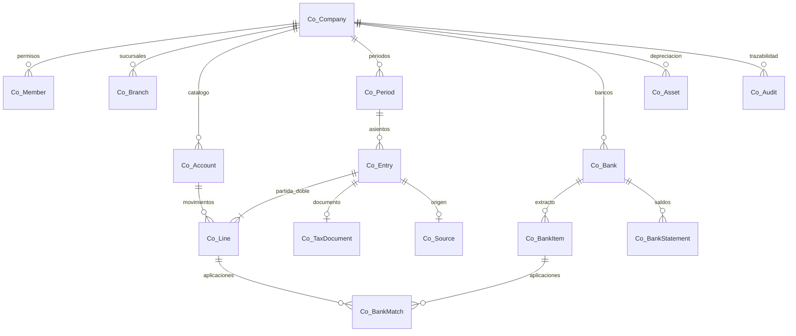

# Modelo de datos y servicios

## Relaciones principales

| Tabla | Restricción / finalidad |
|---|---|
| Co_SchemaVersion | Nombre y hash de migración aplicada |
| Co_Company | RUC único, moneda funcional PEN, régimen, obligación y configuración versionada |
| Co_Member | PK empresa/usuario; permisos de servicio, no datos del cliente |
| Co_Branch | FK empresa; almacén ERP globalmente único en esta instalación |
| Co_Account | PK empresa/código; FK de padre dentro de la misma empresa |
| Co_Period | PK empresa/AAAA-MM; secuencia bajo `FOR UPDATE` |
| Co_Entry | FK compuesta a período/sucursal; origen único por empresa; correlativo único por período; reverso único |
| Co_Line | FK compuesta a asiento/cuenta; céntimos originales y funcionales enteros |
| Co_Source | PK empresa/tipo/ID ERP; hash, revisión, snapshot y enlace a asiento; no actualiza el origen |
| Co_TaxDocument | Registro fiscal, FK empresa/asiento/período tributario; original JSON, conversión a PEN y estado auditable |
| Co_Bank | Cuenta contable independiente; vínculo ERP opcional y único; moneda |
| Co_BankItem | ID externo único por empresa/banco, hash para reimportación |
| Co_BankMatch | Aplicaciones parciales firmadas; FK compuestas a extracto y línea; bloqueo de ambos saldos |
| Co_BankStatement | Rango, saldo inicial/final, evidencia y versión |
| Co_Asset | Costo/residual/vida útil y cuentas de gasto/acumulada |
| Co_ExternalRegister | Propuesta normalizada por período/tipo/documento |
| Co_Audit | Eventos anexados; no hay endpoint para actualizar/borrar |

Todas las tablas nuevas son InnoDB/utf8mb4. No hay ALTER/DELETE/UPDATE de tablas históricas en la migración. Las consultas utilizan nombres canónicos con mayúsculas/minúsculas; en Linux el esquema ERP de origen debe estar correctamente nombrado.

## Servicios

- `accounting-core.php`: permisos, utilidades, cuentas, períodos, partida doble, transiciones, reversos, cierre y anulación fiscal sustentada.
- `accounting-sources.php`: lectura de entidades existentes y regeneración controlada por revisión de origen.
- `accounting-reports.php`: libros, auxiliares, estados, comparativos, tributos y conciliación externa.
- `accounting-operations.php`: plantillas, bancos, importación, aplicaciones, saldos y depreciación.
- `accounting-export.php`: CSV/XLSX/PDF y Diario PLE 5.1.
- `accounting.php`: controlador autenticado; no expone métodos de instalación.
- `accounting-sync.php`: capturador CLI para programación; no contabiliza.

## Seguridad y API

Endpoint: `/api/accounting.php`. Sesión ERP existente; usuario activo en `Seg_Usuario`. Contexto devuelve CSRF y empresas autorizadas. Solo superadmin con perfil administrador puede crear empresas. La pertenencia contable se valida en cada consulta y modificación.

GET: `context`, `company`, `accounts`, `entries`, `entry`, `dashboard`, `report`, `periods`, `branches`, `members`, `banks`, `assets`, `sources`, `source`, `audit`, `reconciliation`, `taxReconciliation`, `export`.

POST con `X-Accounting-CSRF`: `createCompany`, `configure`, `member`, `branch`, `account`, `importAccounts`, `officialCatalog`, `starterCatalog`, `period`, `closePeriod`, `yearClosing`, `draft`, `opening`, `updateDraft`, `transition`, `reverse`, `voidTax`, `template`, `bank`, `statement`, `importBank`, `match`, `asset`, `depreciation`, `capture`, `prepareSource`, `prepareCash`, `resolveSource`, `importExternalRegister`.

POST siempre lleva `companyId`, salvo creación inicial; las referencias cruzadas se validan dentro de esa empresa. `transition` lleva `id,version,transition`; configuración lleva `version`; revisión de origen lleva `sourceId,kind,hash,reviewed` y los datos revisados. Reintentos manuales conservan `sourceId`.

El servidor decide estado, actor, correlativo y permiso. Un POST de asiento manual no puede falsificar un tipo de origen ERP. GET no modifica registros financieros; las exportaciones registran únicamente su auditoría.

## Invariantes

1. Ambas monedas cuadran en céntimos enteros; no se usan floats para el mayor.
2. Tipo de cambio positivo; moneda funcional exige 1; conversión half-up, máximo seis decimales.
3. Importe por línea/documento hasta 9.999.999,99 en moneda original; sumas no superan enteros de PHP de 64 bits.
4. Una línea no puede tener debe y haber positivos a la vez ni ambos cero.
5. Cuenta debe ser activa/de movimiento y de la empresa, tanto al guardar como al contabilizar.
6. Período abierto al crear, revisar, aprobar, contabilizar, editar borrador, anular fiscalmente o revertir dentro de él.
7. Un período histórico cerrado puede tener un reverso fechado en un período posterior abierto; original inmutable.
8. Origen/hash distintos nunca sobrescriben un asiento; los conflictos se resuelven auditablemente y generan una revisión nueva.
9. Cierre mensual rechaza pendientes, conflictos y orígenes con borrador descartado sin resolver.
10. IGV del documento debe conciliar con la cuenta de IGV del asiento original.
11. Banco/movimiento/línea, moneda y signos deben coincidir; aplicaciones no exceden sus saldos.
12. Estado financiero no incluye borradores; el cierre anual no borra el resultado económico del ejercicio.

## Pruebas

El test de dominio integra 102 comprobaciones, base temporal, cuatro trabajadores concurrentes, API HTTP real con CSRF y exportaciones reales. La prueba de navegador usa Vue/BootstrapVue reales y APIs simuladas; cubre formularios, retención de cambios ante error, revisión precargada, búsqueda, estados y pantallas móviles. Se distingue de una prueba fiscal de aceptación SUNAT, que debe realizarse durante la homologación del despliegue.
